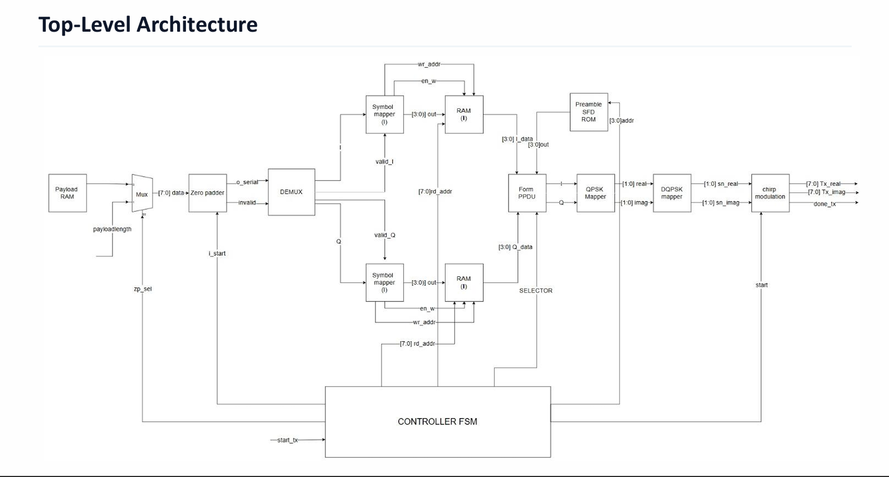

# CSS-Physical-Layer-Transmitter
Digital Implementation of IEEE 802.15.4 Chirp Spread Spectrum (CSS) Physical Layer Transmitter.

## Project Presentation
Click on this photo to view the full presentation:

.pdf>)
